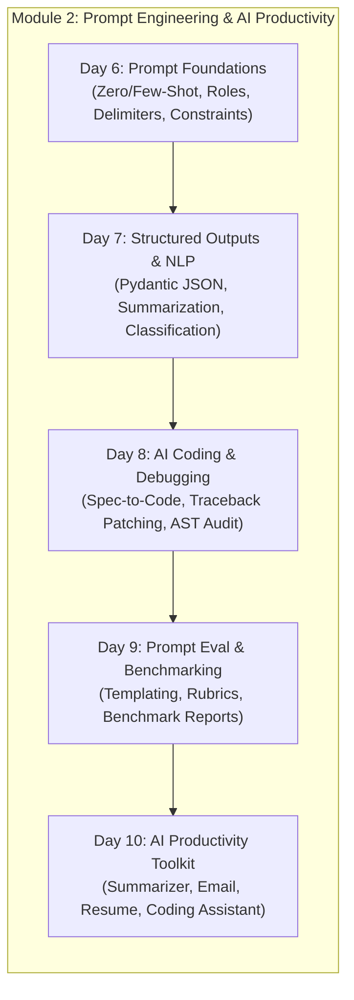
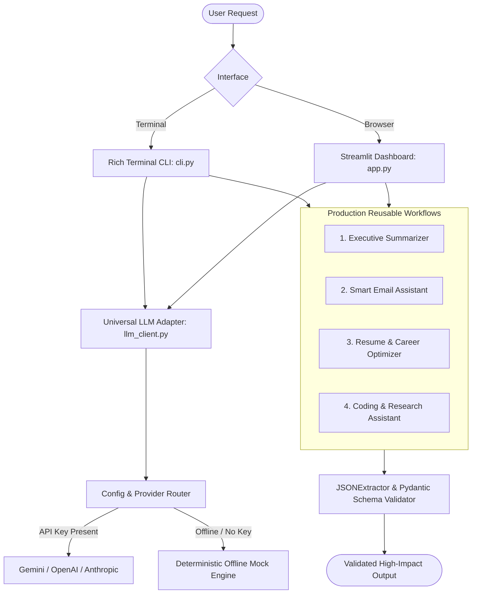

# ⚡ AI Productivity Toolkit & Prompt Engineering Mastery

[](https://www.python.org/)
[](https://opensource.org/licenses/MIT)
[](https://peps.python.org/pep-0008/)
[](tests/)

A comprehensive, production-grade implementation of **Module 2: Prompt Engineering & AI Productivity (Day 6 – Day 10)**. This repository provides foundational to advanced prompt engineering techniques, structured output extraction, AI-assisted debugging, automated prompt benchmarking, and the full-featured **AI Productivity Toolkit** application available as both a **Rich Terminal CLI** and a **Streamlit Web Dashboard**.

---

## 📑 Curriculum & Architecture Roadmap



---

## 🌟 What You'll Learn & What is Implemented

| Day | Topic | Key Deliverables & Implementation |
|---|---|---|
| **Day 6** | **Prompt Foundations** | • Zero-shot vs Few-shot in-context learning<br>• System roles & personas<br>• Delimiter isolation (`<xml>`, `"""`) for injection defense<br>• Negative constraints & guardrail enforcement (`ConstraintValidator`)<br>• Interactive beginner exercises (`exercises.py`) |
| **Day 7** | **Structured Outputs & Core NLP** | • Robust JSON parser & Pydantic schema validation (`JSONExtractor`)<br>• Multi-format summarization engine (TL;DR, Executive, Action Items)<br>• Multi-class support ticket triage & urgency classifier<br>• Automated release notes & technical announcement generator |
| **Day 8** | **AI-Assisted Coding & Debugging** | • Spec-driven code generation (`CodeSpec` to typed Python)<br>• Automated stack trace debugger (`AutomatedDebugger`) generating unified diffs & regression tests<br>• AST static code auditor checking for security risks (eval, hardcoded secrets) & smells |
| **Day 9** | **Prompt Evaluation & Benchmarking** | • Parameterized prompt templating engine (`PromptTemplate`, `TemplateRegistry`)<br>• Automated evaluation harness scoring accuracy, schema adherence, and constraint compliance<br>• Markdown benchmark report generator comparing v1 baseline vs v2 optimized |
| **Day 10** | **Capstone: AI Productivity Toolkit** | • **Executive Summarizer**: Distills complex docs into executive briefs & action items<br>• **Smart Email Assistant**: Calibrates tone, extracts questions, drafts crisp replies<br>• **Resume & Career Optimizer**: ATS match scoring, skills gap detection, Google XYZ bullet points<br>• **Coding & Research Assistant**: Explains algorithms, generates unit tests, fixes bugs<br>• **Dual UI**: Interactive Rich Terminal CLI + Streamlit Web App |

---

## 🛠️ Architecture: The AI Productivity Toolkit



---

## 🚀 Quick Start

### 1. Installation
Clone the repository and install dependencies:
```bash
git clone https://github.com/premkumar1710/ai-productivity-toolkit.git
cd ai-productivity-toolkit
pip install -r requirements.txt
```

### 2. Run the Streamlit Web Application
```bash
streamlit run day_10_productivity_toolkit/app.py
```
Open your browser at `http://localhost:8501` to use the interactive dashboard.

### 3. Run the Rich Terminal CLI
```bash
# Interactive mode
python day_10_productivity_toolkit/cli.py

# Run all 4 automated workflow demonstrations
python day_10_productivity_toolkit/cli.py --demo
```

### 4. Optional: Configure Cloud LLM Keys
The toolkit includes an **intelligent offline mock engine** that simulates realistic LLM behavior without requiring any API keys. To connect live cloud models:
```bash
cp .env.example .env
# Add your key to .env:
# GEMINI_API_KEY=your_key_here  OR  OPENAI_API_KEY=your_key_here
```

---

## 📂 Repository Directory Structure

```text
ai-productivity-toolkit/
├── .github/
│   └── workflows/
│       └── ci.yml                     # Multi-OS CI test workflow
├── data/
│   ├── sample_emails.txt              # Sample incoming enterprise emails
│   ├── sample_resumes.txt             # Sample candidate resume
│   ├── sample_job_description.txt     # Target job description
│   ├── sample_meeting_notes.txt       # Architecture sync meeting notes
│   └── sample_buggy_code.py           # Deliberate buggy snippets for debugging
├── day_06_prompt_foundations/
│   ├── README.md                      # Guide to zero/few-shot, roles, and constraints
│   ├── zero_vs_few_shot.py            # Comparative evaluation script
│   ├── role_and_constraints.py        # Scaffolding and negative constraint validator
│   └── exercises.py                   # Automated exercise grading harness
├── day_07_structured_outputs/
│   ├── README.md                      # Guide to JSON modes, Pydantic schemas, and NLP
│   ├── json_extractor.py              # Resilient JSON parser with self-repair
│   ├── summarization_engine.py        # Multi-format structured summarizer
│   ├── classification_suite.py        # Support ticket triage & sentiment classifier
│   └── generation_lab.py              # Structured release notes & announcement generator
├── day_08_ai_coding_debugging/
│   ├── README.md                      # Guide to spec-driven code, tracebacks, & AST audit
│   ├── spec_to_code.py                # Specification-to-Python code generator
│   ├── automated_debugger.py          # Traceback parser, patch generator & test creator
│   └── code_refactoring_audit.py      # AST static code analyzer for security & smells
├── day_09_eval_and_benchmarking/
│   ├── README.md                      # Guide to prompt evaluation rubrics & testing
│   ├── prompt_template_engine.py      # Parameterized prompt template registry
│   ├── prompt_evaluator.py            # Automated benchmark evaluation harness
│   └── reports/
│       └── prompt_benchmark_report.md # Generated comparative benchmark report
├── day_10_productivity_toolkit/
│   ├── __init__.py
│   ├── config.py                      # Multi-provider configuration
│   ├── llm_client.py                  # Universal LLM client with offline mock fallback
│   ├── modules/
│   │   ├── summarizer.py              # Executive summarizer workflow
│   │   ├── email_assistant.py         # Smart email assistant workflow
│   │   ├── resume_optimizer.py        # Resume & ATS optimizer workflow
│   │   └── coding_assistant.py        # Coding & research assistant workflow
│   ├── templates/
│   │   ├── summarizer_prompts.json    # Reusable prompt templates
│   │   ├── email_prompts.json
│   │   ├── resume_prompts.json
│   │   └── coding_prompts.json
│   ├── cli.py                         # Rich terminal user interface
│   └── app.py                         # Streamlit web application
├── tests/
│   ├── test_day06.py                  # Unit tests for prompt foundations
│   ├── test_day07.py                  # Unit tests for structured outputs & NLP
│   ├── test_day08.py                  # Unit tests for AI coding & debugging
│   ├── test_day09.py                  # Unit tests for prompt evaluation harness
│   └── test_toolkit.py                # Unit tests for the capstone toolkit
├── .env.example
├── .gitignore
├── pyproject.toml
├── requirements.txt
├── QUICKSTART.md
└── README.md
```

---

## 🧪 Testing & Verification

Run the full pytest test suite across all 5 modules:

```bash
pytest tests/ -v
```

### Benchmark Evaluation Sample Output
```text
============================================================
DAY 9: PROMPT BENCHMARK REPORT GENERATOR
============================================================
# Prompt Engineering Benchmark Report

| Metric | Prompt v1 (Baseline) | Prompt v2 (Optimized) | Delta |
|---|---|---|---|
| Overall Quality Score   | 40.0/100 | 100.0/100 | +60.0 pts |
| Ground-Truth Accuracy    | 100.0%   | 100.0%    | 0.0%      |
| JSON Schema Compliance   | 0.0%     | 100.0%    | +100.0%   |
```

---

## 👤 Author
**Premkumar S**  
- GitHub: [@premkumar1710](https://github.com/premkumar1710)  
- Email: [premkumarsenthiltvg@gmail.com](mailto:premkumarsenthiltvg@gmail.com)

---

## 📄 License
This project is licensed under the MIT License - see the LICENSE file for details.
