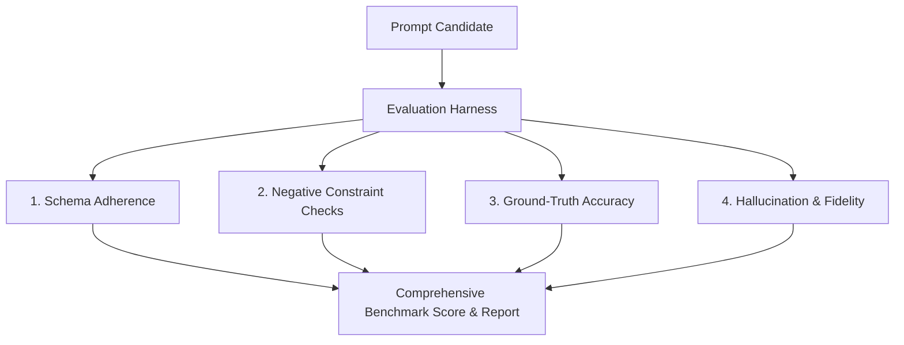

# Day 9: Prompt Evaluation, Testing Framework & Benchmarking

Welcome to **Day 9**! As prompt engineering matures into production engineering, you cannot rely on ad-hoc manual testing in chat web UIs. You need **Reusable Prompt Templates**, **Automated Test Harnesses**, and **Quantitative Benchmark Reports**.

---

## 1. Why Prompt Evaluation is Essential
When you alter a prompt to fix an edge case, you risk causing regressions on previously working cases. An automated evaluation pipeline gives you:
- **Regression Detection:** Identify broken behaviors before deploying to production.
- **A/B Testing & Optimization:** Objectively compare Prompt Version 1 (e.g. Zero-Shot) vs Prompt Version 2 (Few-Shot).
- **Cost & Latency Tracking:** Monitor token consumption and response latency.

---

## 2. Evaluation Dimensions

Our automated harness evaluates prompts against 4 key dimensions:

1. **Schema Adherence (0-100%):** Does the model return valid, parseable JSON conforming to the Pydantic schema?
2. **Negative Constraint Compliance (0-100%):** Did the model avoid forbidden phrases, apologies, and word count overruns?
3. **Factual Accuracy (0-100%):** Did the model assign the correct classification or extract the exact entities?
4. **Efficiency:** Prompt token count, completion token count, and execution latency.

---

## 3. Files in this Directory

| File | Purpose |
|---|---|
| `prompt_template_engine.py` | Dynamic template manager with variable validation, defaults, and version tracking |
| `prompt_evaluator.py` | Automated benchmarking runner scoring prompts across test sets and generating markdown reports |
| `reports/prompt_benchmark_report.md` | Pre-generated benchmark report comparing baseline vs optimized prompts |
